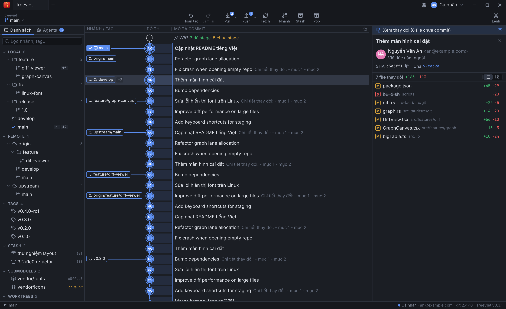
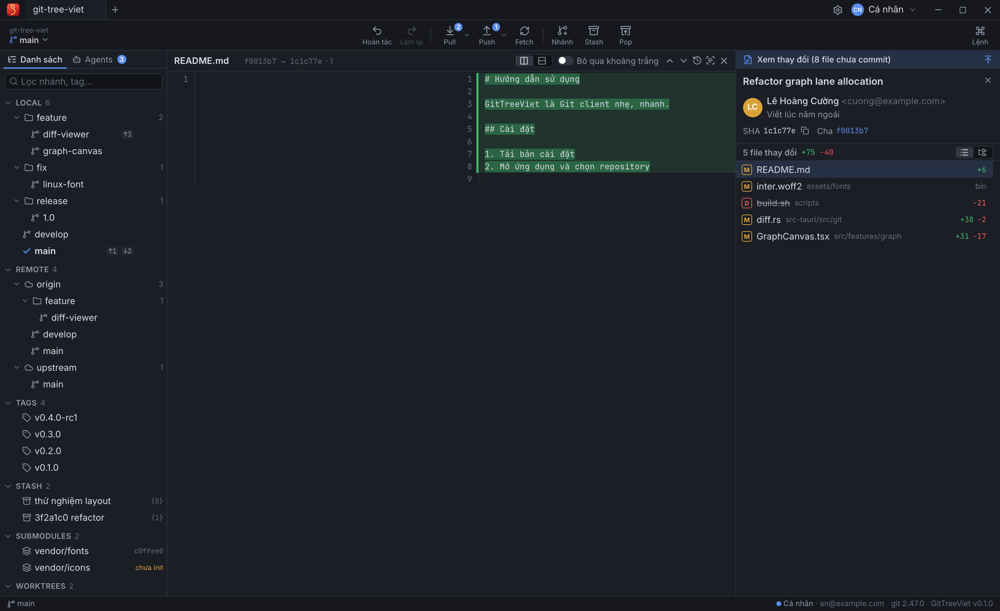
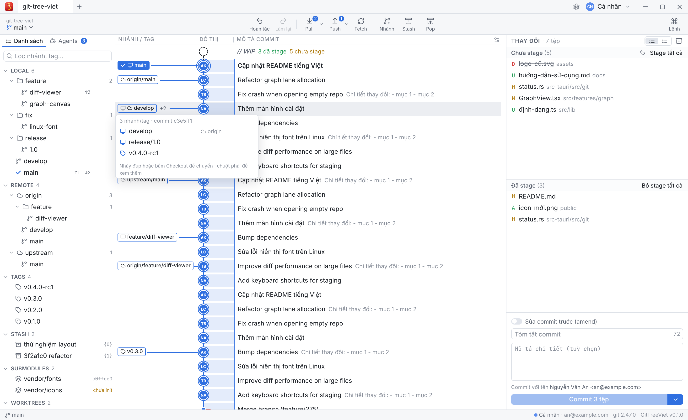
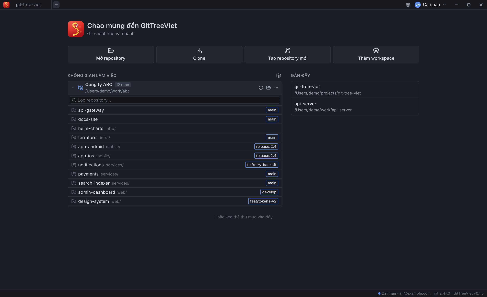
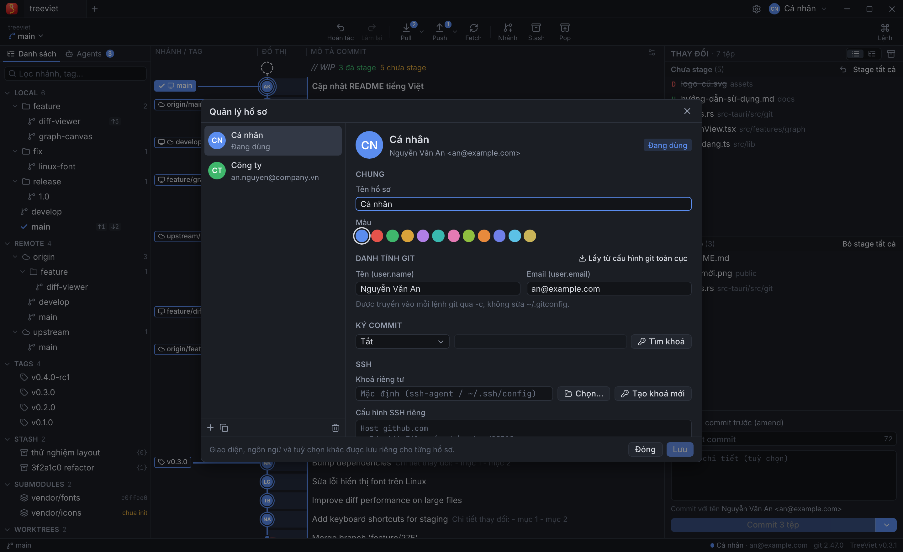

<p align="center">
  
</p>

<h1 align="center">TreeViet for Git</h1>
<p align="center">Ứng dụng cho Git nhẹ và nhanh trên macOS, Windows và Linux<br>A light, fast app for Git on macOS, Windows and Linux</p>

## ⬇ Tải về / Download

| Hệ điều hành / OS | File cài / Installer |
|---|---|
| **macOS** (Apple Silicon + Intel, 11+) | [TreeViet-macOS-universal.dmg](../../releases/latest/download/TreeViet-macOS-universal.dmg) |
| **Windows 10/11** x64 | [TreeViet-Windows-x64-setup.exe](../../releases/latest/download/TreeViet-Windows-x64-setup.exe) |
| **Linux** x64 — Ubuntu/Debian | [TreeViet-Linux-x64.deb](../../releases/latest/download/TreeViet-Linux-x64.deb) |

### Cài đặt / Install
- **macOS**: mở `.dmg`, kéo TreeViet vào *Applications* rồi mở app. Lần đầu macOS báo "Apple không thể xác minh TreeViet…" (do app chưa đăng ký với Apple, không phải mã độc): bấm **Done**, vào **System Settings → Privacy & Security**, kéo xuống bấm **Open Anyway** → **Open** (chỉ cần một lần; macOS 14 trở về trước: chuột phải vào app → **Open**). Hoặc chạy `xattr -dr com.apple.quarantine /Applications/TreeViet.app`.
- **Windows**: chạy `setup.exe`. Nếu SmartScreen hiện "Windows protected your PC": **More info** → **Run anyway**. Cần WebView2 (có sẵn trên Windows 10/11 mới).
- **Linux** (Ubuntu/Debian): `sudo apt install ./TreeViet-Linux-x64.deb`. Nếu cửa sổ trắng trên máy NVIDIA: `WEBKIT_DISABLE_DMABUF_RENDERER=1`.
- Cần cài **Git** trên máy / requires **Git** installed.

### 🧩 Extension cho VS Code / VS Code extension

TreeViet for Git cũng có trong VS Code: commit graph, diff, merge/rebase, profiles… trong một panel, cùng key bản quyền với app desktop.
TreeViet for Git is also available inside VS Code — the same graph, diffs, merge/rebase and profiles in one panel, with the same license key as the desktop app.

| Editor | Cài từ / Install from |
|---|---|
| **VS Code** | [Visual Studio Marketplace](https://marketplace.visualstudio.com/items?itemName=treeviet.treeviet) |
| **Cursor, Windsurf, VSCodium…** | [Open VSX](https://open-vsx.org/extension/treeviet/treeviet) |

**Cách cài / How to install**
1. Mở **Extensions** (`Cmd+Shift+X` trên macOS, `Ctrl+Shift+X` trên Windows/Linux) / open the **Extensions** view.
2. Tìm **TreeViet for Git** (nhà phát hành **TreeViet**) → **Install** / search for **TreeViet for Git** (publisher **TreeViet**) → **Install**.
   Hoặc mở Quick Open (`Cmd+P` / `Ctrl+P`) và dán / or paste into Quick Open: `ext install treeviet.treeviet`
3. Mở graph / open the graph: bấm **TreeViet** ở thanh trạng thái / click **TreeViet** in the status bar, `Cmd+Alt+G` / `Ctrl+Alt+G`, hoặc / or Command Palette → **TreeViet: Open Git Graph**.

Cần VS Code 1.96+ và **Git** / requires VS Code 1.96+ and **Git**.

## 🎁 Dùng thử Pro / Free Pro trial

Dùng thử đầy đủ tính năng Pro (kể cả repository riêng tư) **đến hết ngày 31/12/2026**. Mở TreeViet → **Cài đặt → Bản quyền** (trong VS Code: Command Palette → **TreeViet: Enter License Key**), nhập:

- **Email:** `gittreeviet@gmail.com`
- **Key:**

```
GTV1.eyJ2IjoxLCJpZCI6ImFhOTQ0YzNlLTNjYTgtNGM0NS05YjkzLTIxNTcyNGVjNWMzNiIsImVoIjoiWEFtQUh0bWhEM0RNdk9tb2p4eXVlTmhzTlRpQXhMTEtMcUF5ZkNWLV9wayIsInMiOiJndmRWcGVxM09PbW9TNVVHIiwicGxhbiI6InBybyIsImlhdCI6MTc5MjI2MjY5MSwiZXhwIjoxNzk4NzYxNTk5fQ.nnGY5mkLDJNYrdw_8Fg66mdZkfHS4YF2yR9mDMpNYs1wAHFxr_RUd-7ftylxeK1tF57-FiGxiLg3Lhb9WoivCg
```

Try every Pro feature (including private repositories) **until 31 Dec 2026**: open TreeViet → **Settings → License** and enter the email and key above.

## ✨ Tính năng / Features

- **Commit graph** nhanh với repo lớn (50.000+ commit): avatar tác giả, nhãn nhánh/tag, solo/ẩn nhánh, tìm commit, hover xem mọi nhánh trên một commit.
- **Diff** hai cột / một cột, tô màu từng chữ, bỏ qua khoảng trắng, diff ảnh, blame, lịch sử file, so sánh commit/nhánh.
- **Working tree**: stage/unstage từng file, từng hunk, từng dòng; commit, amend, sửa message commit cuối; stash.
- **Nhánh & remote**: checkout, tạo/đổi tên/xoá nhánh & tag, fetch/pull/push, quản lý remote, undo/redo, submodule, worktree.
- **Merge / Rebase**: kéo thả nhánh, giải quyết conflict 3 cột, interactive rebase, cherry-pick, revert, reset.
- **Profiles**: mỗi hồ sơ có danh tính Git, ký commit (GPG/SSH), SSH key & SSH config, tài khoản HTTPS (GitHub/GitLab/Bitbucket/Gitea) riêng — chuyển đổi tức thì.
- **Workspaces**: mở một thư mục cha, tự nhận diện và nhóm mọi repository bên trong.
- **Agents**: theo dõi các phiên AI coding agent dạng dòng lệnh trên từng worktree, tạo phiên mới chỉ với một cú bấm.

## 🖼 Ảnh chụp / Screenshots








## 🔑 Bản miễn phí & Pro / Free & Pro

- **Miễn phí**: dùng với repository công khai (public) và repository cục bộ.
- **Pro**: mở thêm repository riêng tư (private). Cần đăng nhập bằng email và **key bản quyền** do TreeViet cấp; key gắn với email và có thời hạn sử dụng. Một key dùng cho cả app desktop và extension VS Code.
- Được dùng cho cá nhân và cho công việc / mục đích thương mại. Công ty có thể mua key cho nhân viên — mỗi người một key gắn với email của người đó.
- Mua key / hỗ trợ: **gittreeviet@gmail.com**

### Chính sách mua key / Purchase policy
- Mua key chỉ bao gồm **key bản quyền và thời hạn sử dụng** ghi trên key.
- **Đã mua thì không hoàn tiền**.
- Mỗi key dành cho một người, không chia sẻ hay bán lại.
- **Hỗ trợ**: lỗi ứng dụng và lỗi key (ví dụ không kích hoạt được) — TreeViet sẽ sửa lỗi hoặc cấp lại key cho thời hạn còn lại.

Personal and commercial use are both allowed; companies may buy keys for their staff (one key per person, bound to that person's email). A purchase grants a license key and its period of use only. **All sales are final — no refunds**. Support covers app bugs and faulty keys.

## 🔒 Quyền riêng tư / Privacy

TreeViet **không thu thập, không lưu trữ và không gửi dữ liệu của bạn** cho nhà phát hành: không telemetry, không thống kê, không theo dõi. Mọi dữ liệu (hồ sơ, cài đặt, token, key bản quyền) nằm trên máy bạn. Chi tiết: [PRIVACY.md](PRIVACY.md).

TreeViet **does not collect, store or send your data**: no telemetry, analytics or tracking. See [PRIVACY.md](PRIVACY.md).

## ⚖️ Giấy phép / License

© 2026 TreeViet · gittreeviet@gmail.com. Bạn được tải và sử dụng bản phát hành chính thức; không được sao chép, chỉnh sửa, phân phối lại hay dịch ngược. Xem [LICENSE](LICENSE). Thành phần mã nguồn mở: [THIRD_PARTY_NOTICES.txt](THIRD_PARTY_NOTICES.txt).

You may download and use the official releases; copying, modifying, redistributing or reverse engineering is not permitted. See [LICENSE](LICENSE).

<sub>Git là nhãn hiệu của Software Freedom Conservancy. TreeViet là sản phẩm độc lập, không liên kết hay được bảo trợ bởi dự án Git.<br>Git is a trademark of Software Freedom Conservancy. TreeViet is an independent product, not affiliated with or endorsed by the Git project.</sub>
